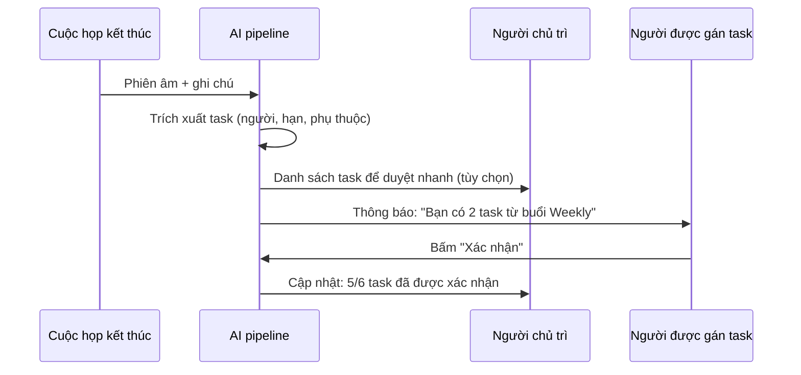
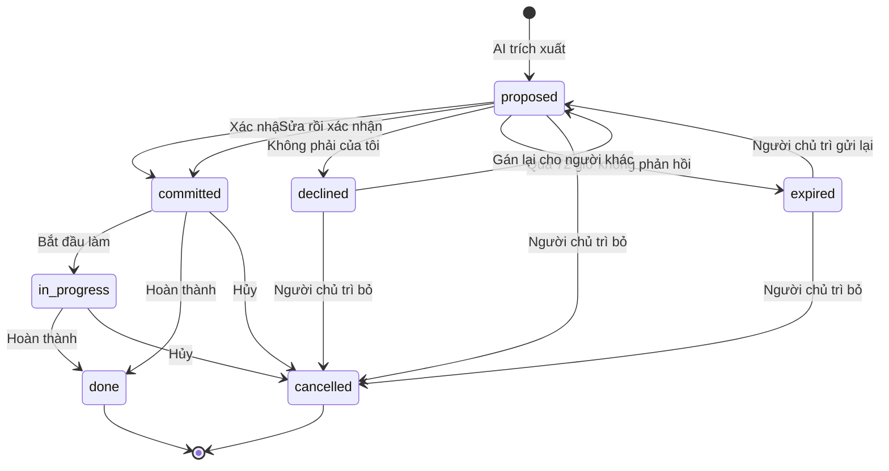

# 3. One-Click Commitment

[← Trang chủ](README.md)

> Sau buổi họp, mỗi người nhận một thông báo liệt kê các task AI cho là của họ, và xác nhận bằng một cú bấm.

## Vì sao cần

Action item trong biên bản chỉ là **đề xuất của AI**. Nó trở thành cam kết khi chính người làm nói "đúng, việc này của tôi, hạn này được". Bước xác nhận này:

- sửa lỗi AI (gán nhầm người, nghe nhầm hạn) trước khi lỗi lan ra;
- tạo ra thời điểm rõ ràng mà người làm nhận trách nhiệm;
- cho [Nudging](04-context-aware-nudging.md) và [Blocker Detection](05-blocker-detection.md) dữ liệu đáng tin để chạy.

## Luồng chính



1. Họp xong, [AI pipeline](08-ai-pipeline.md) trích xuất task trong vòng vài phút.
2. Mỗi người được gán nhận **một** thông báo gom tất cả task của họ từ buổi họp đó (không gửi rời từng task).
3. Trên mỗi task có ba nút:

| Nút | Kết quả |
|---|---|
| **Xác nhận** | Task chuyển sang `committed`. Xong, không cần mở app. |
| **Sửa** | Mở form ngắn: đổi hạn, đổi mô tả, rồi xác nhận. |
| **Không phải của tôi** | Task chuyển sang `declined`, quay về người chủ trì để gán lại. Có thể chọn luôn "Chuyển cho…". |

4. Có thêm nút **Xác nhận tất cả** khi một người có từ 2 task trở lên.
5. Người chủ trì thấy bảng tổng hợp: task nào đã xác nhận, đang chờ, bị từ chối.

## Nội dung một thẻ task

```
Gửi báo cáo doanh thu Q4 cho anh Minh
Hạn: Thứ Sáu 20/11, 17:00
Từ: Họp nhóm Sales, 16/11 · "…Lan gửi giúp anh báo cáo Q4 trước thứ Sáu nhé" (12:34)
Cần cho: Chuẩn bị slide họp ban giám đốc (Hùng)

[ Xác nhận ]   [ Sửa ]   [ Không phải của tôi ]
```

Câu trích dẫn và mốc thời gian giúp người nhận tin rằng task này có thật trong cuộc họp, không phải AI bịa.

## Trạng thái của task



"Trễ hạn" không phải là một trạng thái riêng mà là thuộc tính tính ra: task chưa `done` và đã qua `due_at`.

## Khi không ai phản hồi

| Thời điểm | Hành động |
|---|---|
| Ngay sau họp | Gửi thông báo xác nhận |
| Khoảng trống đầu tiên trong lịch sau 4 giờ | Nhắc lại một lần (dùng cơ chế chọn giờ của [Nudging](04-context-aware-nudging.md)) |
| Sau 24 giờ | Đưa vào bản tổng hợp gửi người chủ trì: "2 task chưa ai nhận" |
| Sau 72 giờ | Task chuyển `expired`, người chủ trì quyết định gửi lại, gán lại hoặc bỏ |

Chỉ nhắc xác nhận **một lần**. Nhắc nhiều hơn sẽ thành spam và người dùng tắt thông báo.

## Trường hợp đặc biệt

| Tình huống | Xử lý |
|---|---|
| AI không chắc ai làm ("ai đó cần kiểm tra lại số liệu") | Không gửi cho ai; đưa vào danh sách "chưa có người nhận" của người chủ trì |
| AI không chắc về hạn | Gửi với hạn để trống hoặc hạn gợi ý có đánh dấu "AI đoán", người nhận phải chọn hạn khi xác nhận |
| Một việc cho nhiều người | Tách thành một task cho mỗi người, hoặc chọn một người chịu trách nhiệm chính; không có task "của chung" |
| Độ tin cậy của AI thấp | Người chủ trì duyệt trước khi gửi đi |
| Task trùng với task đã có từ buổi họp trước | Gợi ý gộp, cập nhật hạn thay vì tạo mới |

## Người nhận chưa dùng app

Người tham gia họp nhưng chưa cài app nhận **email** có nút xác nhận.

- Mỗi nút là một liên kết chứa token đã ký, dùng một lần, hết hạn sau 7 ngày, chỉ gắn với đúng một hành động trên đúng một task.
- Bấm vào mở trang xác nhận tối giản, không bắt đăng nhập.
- Nút trong email chỉ mở trang; hành động thực hiện bằng một cú bấm trên trang đó (POST). Lý do: các bộ lọc email và trình xem trước liên kết tự động mở URL, nếu xác nhận ngay khi mở URL thì task sẽ bị "xác nhận" mà không ai bấm.

## Kênh gửi

Thứ tự ưu tiên theo cài đặt của từng người: thông báo trong app (desktop) → Slack → email. Chi tiết ở [Tích hợp](09-tich-hop.md).

## Chỉ số theo dõi

- Tỷ lệ xác nhận, tỷ lệ sửa, tỷ lệ từ chối (tỷ lệ sửa và từ chối cao nghĩa là AI trích xuất kém).
- Thời gian từ lúc gửi đến lúc xác nhận.
- Số task hết hạn mà không ai phản hồi.

## Phạm vi MVP

| Có | Để sau |
|---|---|
| Thông báo gom theo người, ba nút hành động | Người chủ trì duyệt trước khi gửi |
| Email có liên kết ký cho người chưa dùng app | Slack interactive message |
| Bảng tổng hợp cho người chủ trì | Gộp task trùng giữa các buổi họp |
| Nhắc xác nhận một lần | Đồng bộ sang Jira / Linear / Asana |
