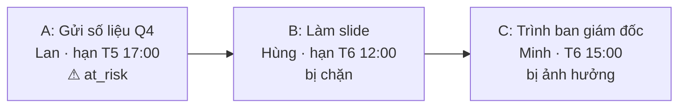

# 5. Blocker Detection

[← Trang chủ](README.md)

> Việc B phụ thuộc việc A. Việc A sắp trễ. Hệ thống cảnh báo cho người làm B và người quản lý ngay khi rủi ro xuất hiện, không đợi đến sát giờ họp.

## Ý tưởng

Mỗi task đã cam kết là một nút trong **đồ thị phụ thuộc**. Hệ thống liên tục ước tính từng task có kịp hạn không, rồi lan truyền rủi ro theo các cạnh phụ thuộc: nếu A trễ thì B sớm nhất có thể bắt đầu lúc nào, và B còn kịp hạn không.

## Phụ thuộc đến từ đâu

| Nguồn | Ví dụ | Độ tin cậy |
|---|---|---|
| AI nghe được trong cuộc họp | "Hùng làm slide sau khi Lan gửi số liệu" | Trung bình, cần xác nhận |
| Người dùng tự nối | Kéo thả hoặc chọn "Việc này cần…" khi xác nhận task | Cao |
| AI suy luận từ nội dung | Task "Duyệt hợp đồng" và "Ký hợp đồng" cùng một hợp đồng | Thấp, chỉ gợi ý |

Phụ thuộc do AI trích xuất hiện trên thẻ task ở bước [One-Click Commitment](03-one-click-commitment.md) (dòng "Cần cho: …"). Khi người làm bấm xác nhận task, phụ thuộc đó cũng được coi là đã xác nhận. Phụ thuộc suy luận ở mức tin cậy thấp không kích hoạt cảnh báo cho đến khi có người xác nhận.

Đồ thị phải là đồ thị có hướng không chu trình. Khi thêm cạnh tạo thành vòng (A chờ B, B chờ A) thì từ chối cạnh đó và báo người dùng.

## Đánh giá rủi ro của một task

Mỗi task mở được xếp vào một mức:

| Mức | Điều kiện (bất kỳ điều kiện nào đúng) |
|---|---|
| `on_track` | Không rơi vào các mức dưới |
| `at_risk` | Thời gian rảnh còn lại trong lịch của người làm trước hạn < công sức còn lại × 1,5 |
| | Chưa bắt đầu khi đã qua 75% thời gian từ lúc cam kết đến hạn |
| | Người làm đã bấm "Tạm hoãn" từ 2 lần trở lên |
| | Người làm có nghỉ phép che gần hết thời gian còn lại |
| | Task chưa được xác nhận (`proposed`) khi còn dưới 48 giờ đến hạn |
| `late` | Đã qua hạn mà chưa `done` |

"Thời gian rảnh còn lại" dùng chung phép tính khoảng trống với [Nudging](04-context-aware-nudging.md#bước-1-tìm-các-khoảng-trống), nên hai tính năng nhất quán với nhau.

Với mỗi task, hệ thống tính **thời điểm dự kiến xong**: xếp công sức còn lại vào các khoảng trống sắp tới của người làm, lấy thời điểm phần cuối cùng được xếp xong. Không đủ dữ liệu lịch thì dùng hạn của task nếu `on_track`, hoặc hạn cộng thêm một khoảng đệm nếu `at_risk`.

## Lan truyền theo phụ thuộc

Với cạnh A → B (B cần A):

```
B.bắt_đầu_sớm_nhất = max(bây giờ, A.dự_kiến_xong)
B.dự_kiến_xong     = xếp công sức của B vào khoảng trống của người làm B,
                     tính từ B.bắt_đầu_sớm_nhất

nếu B.dự_kiến_xong > B.hạn:
    B bị chặn bởi A → tạo cảnh báo blocker
```

- Task có nhiều việc đi trước: lấy thời điểm dự kiến xong **muộn nhất** trong các việc đó.
- Duyệt đồ thị theo thứ tự tô-pô để rủi ro lan qua cả chuỗi A → B → C. Cảnh báo cho C nêu rõ gốc rễ là A.



## Ai nhận cảnh báo

| Người nhận | Nội dung | Mục đích |
|---|---|---|
| Người làm việc bị chặn (B) | "Việc bạn đang chờ có nguy cơ trễ, slide của bạn có thể không kịp 12:00 thứ Sáu" | Chủ động lên phương án |
| Người quản lý | Chuỗi bị ảnh hưởng + các lựa chọn điều chỉnh | Quyết định điều chỉnh kế hoạch |
| Người làm việc gốc (A) | "Hùng đang chờ việc này để làm slide" | Biết việc mình đang chặn người khác; giọng điệu hỗ trợ, không trách móc |

"Người quản lý" mặc định là người chủ trì cuộc họp sinh ra task B; nhóm có thể chỉ định người khác. Xem [Quyết định còn mở](12-quyet-dinh-mo.md).

## Nội dung cảnh báo

```
⚠ Nguy cơ chặn: "Làm slide họp ban giám đốc" (Hùng, hạn T6 12:00)

Đang chờ: "Gửi số liệu Q4" (Lan, hạn T5 17:00)
Vì sao có nguy cơ: Lan chưa bắt đầu, và chỉ còn 40 phút trống trong lịch
trước hạn, trong khi việc ước tính cần 90 phút.
Tác động: slide dự kiến xong T6 14:00, trễ 2 tiếng so với hạn, chỉ còn
1 tiếng trước buổi trình ban giám đốc lúc 15:00.

Gợi ý:
 · Dời hạn slide sang T6 14:30 (vẫn trước buổi trình)
 · Hùng bắt đầu slide với số liệu tạm, cập nhật sau
 · Chuyển "Gửi số liệu Q4" cho người khác

[ Xem chuỗi phụ thuộc ]   [ Nhắn Lan ]   [ Đã xử lý ]
```

Mỗi cảnh báo luôn có ba phần: **việc gì bị ảnh hưởng**, **vì sao hệ thống cho là có nguy cơ**, **có thể làm gì**. Cảnh báo chỉ nêu vấn đề mà không gợi ý lối ra thì chỉ tạo thêm lo lắng.

## Khi nào chạy

- **Theo sự kiện:** task đổi trạng thái, đổi hạn, đổi người làm; lịch của người làm thay đổi; thêm hoặc bớt phụ thuộc.
- **Định kỳ:** mỗi 30 phút trong giờ làm việc, để bắt các rủi ro do thời gian trôi (không có sự kiện nào nhưng hạn đang đến gần).

## Chống cảnh báo thừa

| Quy tắc | Lý do |
|---|---|
| Mỗi cặp (A, B) chỉ cảnh báo khi mức rủi ro **thay đổi** | Không lặp lại cùng một cảnh báo mỗi 30 phút |
| Mức rủi ro phải giữ nguyên 2 lần đánh giá liên tiếp mới gửi | Tránh nhấp nháy khi lịch thay đổi liên tục |
| Một chuỗi dài chỉ gửi một cảnh báo cho người quản lý, liệt kê cả chuỗi | Không gửi 5 cảnh báo cho 5 task cùng một gốc rễ |
| Cảnh báo cho người làm đi qua bộ chọn giờ của Nudging; cảnh báo mức `late` thì gửi ngay | Không làm phiền giữa cuộc họp trừ khi thật sự gấp |
| Người quản lý có thể chọn nhận bản tổng hợp hằng ngày thay vì từng cảnh báo | Quản lý nhiều nhóm sẽ quá tải |
| Bấm "Đã xử lý" tắt cảnh báo cho đến khi tình hình xấu đi thêm | Tôn trọng quyết định của con người |

## Giới hạn cần biết

- Chất lượng phụ thuộc vào **công sức ước tính** và **lịch**. Lịch không phản ánh mọi việc người ta đang làm, nên "thời gian rảnh" là ước lượng lạc quan. Hệ số 1,5 bù một phần cho điều này.
- Hệ thống chỉ biết các task sinh ra từ cuộc họp. Người làm bận vì việc khác bên ngoài thì hệ thống không thấy.
- Cảnh báo là **tín hiệu để con người xem xét**, không tự động dời hạn hay gán lại việc.

## Phạm vi MVP

| Có | Để sau |
|---|---|
| Phụ thuộc do AI trích xuất + người dùng tự nối | Phụ thuộc suy luận từ nội dung |
| Mức rủi ro theo quy tắc ở bảng trên | Mô hình dự đoán học từ lịch sử trễ hạn |
| Lan truyền một bậc (A → B) | Lan truyền cả chuỗi nhiều bậc |
| Cảnh báo cho người làm B và người chủ trì | Bản tổng hợp hằng ngày, giao diện đồ thị |
