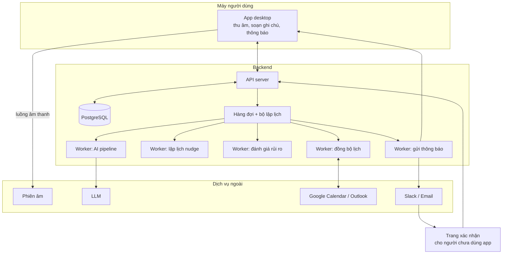

# 6. Kiến trúc hệ thống

[← Trang chủ](README.md)

> Trang này mô tả kiến trúc **đề xuất**. Các lựa chọn công nghệ cụ thể chưa chốt, xem [Quyết định còn mở](12-quyet-dinh-mo.md).

## Sơ đồ tổng thể



## Các thành phần

### App desktop

- Thu âm hệ thống và micro, gửi luồng âm thanh đi phiên âm.
- Trình soạn ghi chú thô, hiển thị phiên âm chạy theo thời gian thực.
- Hiển thị thông báo hệ điều hành có nút hành động (Xác nhận, Xong rồi, Tạm hoãn).
- Danh sách task của tôi, bảng tổng hợp cho người chủ trì.

### Thu âm

Đây là phần khó nhất về kỹ thuật và phụ thuộc nền tảng:

| Nền tảng | Cách thu âm hệ thống | Ghi chú |
|---|---|---|
| macOS | Core Audio process tap (macOS 14.4 trở lên) hoặc ScreenCaptureKit | Cần quyền ghi âm thanh hệ thống; cần module native viết bằng Swift |
| Windows | WASAPI loopback | Không cần quyền đặc biệt |
| Trình duyệt | `getDisplayMedia` với âm thanh của tab | Chỉ thu được tab đang chia sẻ, trải nghiệm kém hơn |

Micro thu riêng thành luồng thứ hai để tách "Tôi" và "Người khác".

### API server

- Xác thực, quản lý workspace, cuộc họp, ghi chú, task.
- Nhận hành động từ nút bấm (app, Slack, liên kết email) và chuyển trạng thái task.
- Nhận webhook từ lịch và Slack.

### Hàng đợi và bộ lập lịch

Trái tim của ba tính năng mới. Cần hai khả năng:

1. **Job chạy ngay**: họp xong → chạy AI pipeline; task đổi trạng thái → đánh giá lại rủi ro.
2. **Job hẹn giờ có thể hủy và dời**: mỗi nudge là một job hẹn giờ. Khi lịch thay đổi, job cũ bị hủy và job mới được tạo.

Mỗi job nudge lưu khóa duy nhất theo `(task, loại nudge)` để không bao giờ có hai lời nhắc cùng loại cho một task. Trước khi gửi, worker kiểm tra lại điều kiện (task còn mở, người nhận đang rảnh).

### Các worker

| Worker | Kích hoạt bởi | Việc làm |
|---|---|---|
| AI pipeline | Cuộc họp kết thúc | Viết biên bản, trích xuất task. Xem [AI pipeline](08-ai-pipeline.md) |
| Lập lịch nudge | Task được cam kết; lịch hoặc task thay đổi | Tính thời điểm nhắc. Xem [Nudging](04-context-aware-nudging.md) |
| Đánh giá rủi ro | Sự kiện trên task hoặc lịch; định kỳ 30 phút | Tính mức rủi ro, lan truyền, tạo cảnh báo. Xem [Blocker Detection](05-blocker-detection.md) |
| Gửi thông báo | Nudge đến giờ; cảnh báo mới; task mới cần xác nhận | Chọn kênh, gửi, ghi nhận kết quả |
| Đồng bộ lịch | Webhook từ nhà cung cấp lịch; định kỳ để dự phòng | Cập nhật bản sao lịch bận/rảnh |

### Bản sao lịch

Không gọi API lịch mỗi lần cần tính khoảng trống. Thay vào đó giữ một bản sao bận/rảnh trong database cho khoảng 14 ngày tới, cập nhật qua webhook của nhà cung cấp lịch và đồng bộ định kỳ để dự phòng khi webhook rớt.

Cả Nudging và Blocker Detection dùng chung **một module tính khoảng trống** đọc từ bản sao này.

## Ba luồng dữ liệu chính

**Họp xong → task chờ xác nhận**

```
App báo cuộc họp kết thúc → API lưu phiên âm + ghi chú thô
→ job AI pipeline → biên bản + danh sách task (proposed)
→ job gửi thông báo cho từng người được gán
```

**Xác nhận → lập lịch nhắc**

```
Người dùng bấm Xác nhận → API chuyển task sang committed
→ job lập lịch nudge (đọc bản sao lịch, tạo các job hẹn giờ)
→ job đánh giá rủi ro cho task này và các task phụ thuộc
```

**Lịch thay đổi → tính lại**

```
Webhook lịch → worker đồng bộ cập nhật bản sao
→ với mỗi task mở của người đó: lập lịch lại nudge + đánh giá lại rủi ro
```

## Ngăn xếp công nghệ đề xuất

| Lớp | Đề xuất | Lý do |
|---|---|---|
| App desktop | Electron + TypeScript + React, module native nhỏ cho thu âm | Một codebase cho macOS và Windows; cùng ngôn ngữ với backend |
| Backend | Node.js + TypeScript | Chia sẻ kiểu dữ liệu với client |
| Database | PostgreSQL | Dữ liệu quan hệ; truy vấn đệ quy cho đồ thị phụ thuộc; tìm toàn văn có sẵn |
| Hàng đợi | Thư viện hàng đợi chạy trên chính PostgreSQL | Bớt một hạ tầng phải vận hành ở giai đoạn đầu |
| Phiên âm | Dịch vụ streaming hỗ trợ tiếng Việt | Cần thử chất lượng tiếng Việt trước khi chọn |
| LLM | Claude | Trích xuất có cấu trúc, xử lý tốt văn bản dài |
| Trang xác nhận | Trang web tĩnh tối giản gọi API | Nhẹ, mở nhanh trên điện thoại |

## Nguyên tắc thiết kế

- **Mọi hành động một cú bấm phải lặp lại an toàn.** Bấm Xác nhận hai lần, hoặc từ hai kênh, cho cùng một kết quả.
- **Mọi thông báo đều ghi lại lý do.** Mỗi nudge và cảnh báo lưu kèm dữ liệu đã dùng để quyết định (khoảng trống nào, điểm bao nhiêu, quy tắc rủi ro nào). Cần cho việc gỡ lỗi và để trả lời "sao nó nhắc tôi lúc này?".
- **Lịch là dữ liệu tham khảo, không phải sự thật.** Luôn kiểm tra lại ngay trước khi gửi.
- **AI đề xuất, con người quyết định.** Không tự dời hạn, không tự gán lại việc.
