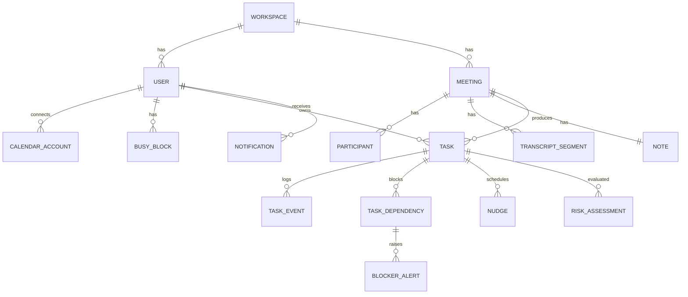

# 7. Mô hình dữ liệu

[← Trang chủ](README.md)

> Tên bảng và cột bằng tiếng Anh để dùng thẳng trong code. Schema đang chạy (giai đoạn 1 và 2) nằm ở `src/schema.sql`; trang này mô tả mô hình đầy đủ cho cả các giai đoạn sau.

## Schema đang chạy khác gì trang này

- Đã có: `meetings`, `participants`, `transcript_segments`, `tasks`, `task_events`, `action_tokens`, `notifications`, và từ giai đoạn 2: `calendar_people`, `busy_blocks`, `nudges`.
- Chưa có: `workspaces`, `users`, `calendar_accounts`, `task_dependencies`, `risk_assessments`, `blocker_alerts`.
- Chưa có tài khoản nên `busy_blocks` gắn với `person_email` thay cho `user_id`. Giờ làm việc và múi giờ của từng người nằm ở bảng `calendar_people` (khóa là email), thay cho `users`. Có dòng trong `calendar_people` nghĩa là người đó "có dữ liệu lịch".
- `meetings` có thêm `next_occurrence_at` (buổi kế tiếp, thay cho `series_id`). `tasks` có `related_meeting_title` và `related_meeting_at` thay cho `related_meeting_series_id`, cùng `nudge_snooze_count` và `nudge_snoozed_until` cho nút "Nhắc ở khoảng trống sau".
- `nudges` có thêm `sent_at`, `created_at`, `updated_at`. Cột `reason` lưu mốc, khoảng trống, điểm, và lý do nếu lời nhắc bị hủy hay bỏ qua.
- `action_tokens.action` có thêm `done`, `start`, `snooze`, `reschedule` cho các nút trên email nhắc việc.
- `participants` có thêm `is_organizer` và `position`; người chủ trì là người đầu tiên trong danh sách, chưa có `meetings.organizer_id`.
- `tasks` có thêm: `position` (thứ tự trong cuộc họp), `needs_review` (chờ người chủ trì duyệt), `sent_at` và `reminder_sent_at` (đã gửi, đã nhắc), `owner_confidence`, `due_spoken_as`.
- `notifications` lưu thêm nội dung email khi chạy không có SMTP, để xem ở trang `/outbox`. Khi gửi thật thì không lưu, vì nội dung chứa liên kết còn hiệu lực.

## Sơ đồ quan hệ

## Các bảng chính

### `meetings`

| Cột | Kiểu | Ghi chú |
|---|---|---|
| `id` | uuid | |
| `workspace_id` | uuid | |
| `title` | text | |
| `started_at`, `ended_at` | timestamptz | |
| `organizer_id` | uuid → users | Người quản lý mặc định cho các task sinh ra |
| `calendar_event_id` | text | Sự kiện lịch tương ứng |
| `series_id` | text | Chuỗi họp định kỳ, dùng để tìm "cuộc họp liên quan" kế tiếp |
| `template` | text | standup, weekly, one_on_one… |

### `participants`

Người tham gia một cuộc họp. Có thể chưa có tài khoản.

| Cột | Kiểu | Ghi chú |
|---|---|---|
| `meeting_id` | uuid | |
| `user_id` | uuid, nullable | Null nếu chưa dùng app |
| `email` | text | Để gửi liên kết xác nhận |
| `display_name` | text | Tên xuất hiện trong lịch, dùng khi AI khớp tên |

### `tasks`

| Cột | Kiểu | Ghi chú |
|---|---|---|
| `id` | uuid | |
| `meeting_id` | uuid | Cuộc họp sinh ra task |
| `title` | text | |
| `owner_participant_id` | uuid, nullable | Null khi AI không xác định được người làm |
| `status` | enum | `proposed`, `committed`, `in_progress`, `done`, `declined`, `expired`, `cancelled` |
| `due_at` | timestamptz, nullable | |
| `due_is_inferred` | boolean | Hạn do AI đoán, chưa ai xác nhận |
| `effort_minutes` | int | AI ước tính, người dùng sửa được |
| `related_meeting_series_id` | text, nullable | Cho nhắc chuẩn bị |
| `source_segment_id` | uuid | Đoạn phiên âm làm bằng chứng |
| `source_quote` | text | Câu trích dẫn hiển thị trên thẻ task |
| `confidence` | real | Độ tin cậy của AI, 0–1 |
| `committed_at` | timestamptz | |
| `completed_at` | timestamptz | |

### `task_events`

Nhật ký chỉ ghi thêm cho mọi thay đổi trên task. Nguồn dữ liệu cho các chỉ số và cho việc trả lời "ai đổi hạn, lúc nào".

| Cột | Kiểu | Ghi chú |
|---|---|---|
| `task_id` | uuid | |
| `type` | text | `proposed`, `confirmed`, `amended`, `declined`, `reassigned`, `snoozed`, `started`, `completed`, `due_changed`… |
| `actor_participant_id` | uuid, nullable | Null nếu do hệ thống |
| `channel` | text | `app`, `slack`, `email_link`, `system` |
| `payload` | jsonb | Giá trị cũ và mới |
| `created_at` | timestamptz | |

### `task_dependencies`

Cạnh của đồ thị phụ thuộc: `blocked_task_id` cần `blocking_task_id` xong trước.

| Cột | Kiểu | Ghi chú |
|---|---|---|
| `blocking_task_id` | uuid | Việc A |
| `blocked_task_id` | uuid | Việc B |
| `source` | enum | `ai_extracted`, `manual`, `ai_inferred` |
| `confirmed` | boolean | Chỉ cạnh đã xác nhận mới kích hoạt cảnh báo |

Ràng buộc: không tự trỏ vào mình, không trùng cặp, và kiểm tra không tạo chu trình khi thêm (truy vấn đệ quy từ `blocked_task_id` xem có đi tới `blocking_task_id` không).

### `busy_blocks`

Bản sao lịch bận/rảnh, khoảng 14 ngày tới.

| Cột | Kiểu | Ghi chú |
|---|---|---|
| `user_id` | uuid | |
| `starts_at`, `ends_at` | timestamptz | |
| `kind` | enum | `meeting`, `focus`, `out_of_office` |
| `calendar_event_id` | text | Để cập nhật khi sự kiện thay đổi |

Cố ý **không lưu tiêu đề hay mô tả** của sự kiện lịch ở đây. Xem [Bảo mật](10-bao-mat-quyen-rieng-tu.md).

### `nudges`

| Cột | Kiểu | Ghi chú |
|---|---|---|
| `task_id` | uuid | |
| `kind` | enum | `confirm_reminder`, `prep`, `gap`, `deadline` |
| `scheduled_for` | timestamptz | |
| `status` | enum | `scheduled`, `sent`, `cancelled`, `skipped` |
| `reason` | jsonb | Vì sao chọn thời điểm này: khoảng trống nào, điểm bao nhiêu |
| `response` | text, nullable | `done`, `started`, `snoozed`, `due_changed`, hoặc null nếu không phản hồi |

Ràng buộc duy nhất trên `(task_id, kind)` với các dòng đang `scheduled`.

### `risk_assessments`

| Cột | Kiểu | Ghi chú |
|---|---|---|
| `task_id` | uuid | |
| `level` | enum | `on_track`, `at_risk`, `late` |
| `projected_finish_at` | timestamptz | |
| `reasons` | jsonb | Các quy tắc đã kích hoạt, kèm số liệu |
| `assessed_at` | timestamptz | |

Giữ lịch sử để so sánh hai lần đánh giá liên tiếp (quy tắc chống nhấp nháy).

### `blocker_alerts`

| Cột | Kiểu | Ghi chú |
|---|---|---|
| `blocking_task_id`, `blocked_task_id` | uuid | Cặp (A, B) |
| `root_task_id` | uuid | Gốc rễ của chuỗi, có thể khác A |
| `level` | enum | Mức rủi ro lúc cảnh báo |
| `projected_delay_minutes` | int | B dự kiến trễ bao lâu |
| `status` | enum | `open`, `acknowledged`, `resolved` |

### `notifications`

Mọi thứ đã gửi đi, bất kể loại: yêu cầu xác nhận, nudge, cảnh báo blocker.

| Cột | Kiểu | Ghi chú |
|---|---|---|
| `recipient_participant_id` | uuid | |
| `channel` | enum | `app`, `slack`, `email` |
| `kind` | text | |
| `ref_id` | uuid | Trỏ về nudge, alert hoặc nhóm task |
| `sent_at`, `opened_at`, `acted_at` | timestamptz | |

Dùng bảng này để thực thi giới hạn "tối đa 3 lần nhắc mỗi ngày, cách nhau 90 phút".

### Các bảng còn lại

- `workspaces`, `users` — tài khoản, giờ làm việc, múi giờ, kênh thông báo ưa thích.
- `calendar_accounts` — token OAuth (mã hóa), trạng thái đồng bộ.
- `transcript_segments` — đoạn phiên âm: người nói, mốc thời gian, nội dung.
- `notes` — ghi chú thô của người dùng và biên bản AI hoàn thiện.
- `action_tokens` — token dùng một lần cho liên kết xác nhận trong email: mã băm của token, task, hành động, hạn dùng, thời điểm đã dùng.
