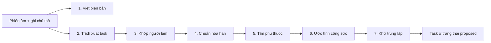

# 8. AI pipeline

[← Trang chủ](README.md)

Chạy một lần khi cuộc họp kết thúc. Đầu vào: bản phiên âm, ghi chú thô, danh sách người tham gia, ngày giờ họp, các task còn mở của nhóm.



## Các bước

### 1. Viết biên bản

Kết hợp ghi chú thô và phiên âm theo mẫu của cuộc họp. Xem [Tính năng lõi](02-tinh-nang-loi.md#23-ghi-chú-thô--ai-hoàn-thiện).

### 2. Trích xuất task

Tìm các câu mang tính cam kết hoặc giao việc. Phân biệt:

| Là task | Không phải task |
|---|---|
| "Lan gửi giúp anh báo cáo trước thứ Sáu nhé" | "Chúng ta nên cải thiện quy trình" (ý kiến chung) |
| "Để em kiểm tra lại rồi báo anh" | "Tuần trước em đã gửi rồi" (việc đã xong) |
| "Ai đó cần hỏi lại bên pháp lý" (task chưa có người làm) | "Nếu khách đồng ý thì mình mới làm" (điều kiện chưa xảy ra, ghi chú riêng) |

Mỗi task bắt buộc kèm **câu trích dẫn nguyên văn** và mốc thời gian. Task không có bằng chứng trong phiên âm thì bị loại. Đây là hàng rào chính chống AI bịa task.

### 3. Khớp người làm

Tên trong lời nói phải khớp về một người trong danh sách tham gia.

- Tiếng Việt xưng hô theo vai: "anh Minh", "chị Lan", "em", "sếp". Cần giải nghĩa "em", "tôi", "mình" theo người đang nói.
- Luồng micro riêng cho biết câu nào do chính người dùng app nói, giúp giải nghĩa "để tôi làm".
- Hai người cùng tên, hoặc không khớp ai: để trống người làm, giảm độ tin cậy.

### 4. Chuẩn hóa hạn

Chuyển cách nói tương đối thành thời điểm cụ thể, tính theo ngày họp và múi giờ của người làm.

| Lời nói | Kết quả (họp ngày thứ Hai 16/11/2026) |
|---|---|
| "trước thứ Sáu" | Thứ Sáu 20/11, cuối giờ làm việc |
| "cuối tuần này" | Cần quy ước của nhóm; mặc định thứ Sáu 20/11, cuối giờ làm việc |
| "trước buổi họp tuần sau" | Giờ bắt đầu lần kế tiếp của chuỗi họp; đồng thời gán `related_meeting_series_id` |
| "sớm nhất có thể" | Không có hạn; đánh dấu để người nhận tự chọn |

Hạn do AI suy ra luôn đánh dấu `due_is_inferred` để người nhận thấy và sửa khi xác nhận.

### 5. Tìm phụ thuộc

Tìm các dấu hiệu thứ tự: "sau khi", "xong rồi thì", "đợi… rồi", "cần… trước". Chỉ tạo cạnh giữa hai task cùng được trích xuất, hoặc với một task đang mở của nhóm. Xem [Blocker Detection](05-blocker-detection.md#phụ-thuộc-đến-từ-đâu).

### 6. Ước tính công sức

Phân loại vào các mức thô thay vì đoán số phút chính xác:

| Mức | Phút | Ví dụ |
|---|---|---|
| Rất nhanh | 15 | Gửi một email, chuyển tiếp tài liệu |
| Ngắn | 30 | Rà soát tài liệu ngắn, cập nhật một bảng |
| Vừa | 60 | Viết báo cáo ngắn, chuẩn bị vài slide |
| Dài | 120 | Phân tích số liệu, viết đề xuất |
| Rất dài | 240+ | Việc nhiều ngày; gợi ý người làm tách nhỏ |

Người dùng sửa được khi xác nhận. Lịch sử sửa dùng để hiệu chỉnh dần.

### 7. Khử trùng lặp

So với các task đang mở của cùng nhóm. Nếu trùng (cùng người, cùng nội dung) thì gợi ý cập nhật task cũ thay vì tạo mới. Thường gặp ở họp định kỳ, khi việc tuần trước chưa xong được nhắc lại.

## Định dạng đầu ra

LLM trả về JSON theo schema cố định (dùng tính năng đầu ra có cấu trúc của mô hình), ví dụ một task:

```json
{
  "title": "Gửi báo cáo doanh thu Q4 cho anh Minh",
  "owner": { "participant_id": "p_lan", "confidence": 0.92 },
  "due": {
    "at": "2026-11-20T17:00:00+07:00",
    "inferred": true,
    "spoken_as": "trước thứ Sáu"
  },
  "effort_minutes": 60,
  "related_meeting": { "kind": "next_in_series" },
  "evidence": {
    "quote": "Lan gửi giúp anh báo cáo Q4 trước thứ Sáu nhé",
    "segment_id": "seg_0142",
    "at_seconds": 754
  },
  "depends_on": [],
  "blocks": [{ "task_ref": "t2", "quote": "Hùng đợi số liệu của Lan rồi làm slide" }],
  "confidence": 0.88
}
```

Backend kiểm tra lại mọi thứ LLM trả về: `participant_id` có trong danh sách không, `segment_id` có tồn tại và câu trích dẫn có thật sự nằm trong đoạn đó không, hạn có nằm trong tương lai không.

## Ngưỡng độ tin cậy

| Độ tin cậy | Xử lý |
|---|---|
| Cao | Gửi thẳng cho người làm để xác nhận |
| Trung bình | Gửi, kèm nhãn "AI không chắc" ở phần không chắc (người làm hoặc hạn) |
| Thấp | Chỉ hiện cho người chủ trì trong danh sách "có thể là task" |

Ngưỡng cụ thể đặt sau khi có bộ dữ liệu đánh giá.

## Chọn mô hình

| Việc | Yêu cầu | Loại mô hình |
|---|---|---|
| Trích xuất task, phụ thuộc | Chính xác là trên hết, chạy một lần mỗi cuộc họp | Mô hình mạnh |
| Viết biên bản | Chất lượng văn bản | Mô hình mạnh hoặc trung bình |
| Viết nội dung nudge, cảnh báo | Ngắn, nhiều lượt, cần nhanh | Mô hình nhỏ, hoặc mẫu câu cố định không cần LLM |

Việc chọn thời điểm nhắc và đánh giá rủi ro là **thuật toán thuần**, không dùng LLM: cần kết quả lặp lại được và giải thích được.

## Đánh giá chất lượng

Xây một bộ phiên âm mẫu (Việt, Anh, trộn) đã gán nhãn task bằng tay, rồi đo sau mỗi lần đổi prompt hoặc mô hình:

- **Precision** của task: bao nhiêu task trích ra là thật. Sai ở đây gây phiền trực tiếp cho người dùng, nên ưu tiên cao nhất.
- **Recall** của task: bao nhiêu task thật được tìm thấy.
- Tỷ lệ đúng người làm, đúng hạn, đúng phụ thuộc.

Sau khi chạy thật, tỷ lệ "Sửa" và "Không phải của tôi" ở [One-Click Commitment](03-one-click-commitment.md) là thước đo liên tục.
