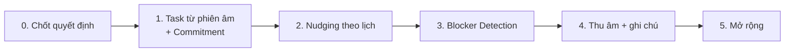

# 11. Roadmap

[← Trang chủ](README.md)

> Thứ tự các giai đoạn là đề xuất. Chưa có mốc ngày vì chưa chốt nền tảng và nguồn lực, xem [Quyết định còn mở](12-quyet-dinh-mo.md).

## Chiến lược

Ba tính năng mới **không phụ thuộc vào việc thu âm**. Chúng chỉ cần một bản phiên âm làm đầu vào. Vì vậy có hai cách đi:

| Cách | Mô tả | Ưu | Nhược |
|---|---|---|---|
| **A. Lõi trước** | Làm thu âm và ghi chú như Granola, rồi mới thêm ba tính năng | Sản phẩm trọn vẹn từ đầu | Phần khó về kỹ thuật (thu âm hệ thống) nằm ngay đầu; lâu mới kiểm chứng được điểm khác biệt |
| **B. Khác biệt trước** (đề xuất) | Giai đoạn đầu nhận phiên âm dán vào hoặc tải lên, làm ba tính năng mới trước, thu âm làm sau | Kiểm chứng sớm thứ làm app khác Granola; lùi rủi ro kỹ thuật lại | Lúc đầu chưa phải là "app ghi chú họp" hoàn chỉnh |

Roadmap dưới đây theo cách B.

## Các giai đoạn

### Giai đoạn 0: Chốt quyết định

- Trả lời các mục ở [Quyết định còn mở](12-quyet-dinh-mo.md).
- Thu thập 10–20 bản phiên âm cuộc họp thật (đã xin phép) làm dữ liệu thử cho AI.

**Xong khi:** các quyết định mức "chặn" đã có câu trả lời.

### Giai đoạn 1: Task từ phiên âm + One-Click Commitment

- Nhập phiên âm (dán hoặc tải tệp) cùng danh sách người tham gia.
- [AI pipeline](08-ai-pipeline.md): trích xuất task, người làm, hạn, có bằng chứng trích dẫn.
- Gửi yêu cầu xác nhận qua email với liên kết ký; trang xác nhận.
- Bảng tổng hợp cho người chủ trì.
- Mô hình dữ liệu `tasks`, `task_events`, `action_tokens`.

**Xong khi:** một nhóm thật dùng cho các buổi họp của mình trong 2 tuần và tỷ lệ xác nhận đạt mục tiêu ở [Tổng quan](01-tong-quan-san-pham.md#thước-đo-thành-công).

**Tình trạng (2026-11-14):** đã có code cho toàn bộ các mục trên, cách chạy ở [README của mã nguồn](../README.vi.md).

| Hạng mục | Tình trạng |
|---|---|
| Nhập phiên âm, tách đoạn, danh sách người tham gia | Xong, có test |
| Kiểm tra kết quả AI (trích dẫn phải có trong phiên âm) | Xong, có test |
| Email gom theo người, ba nút, Xác nhận tất cả, trang xác nhận | Xong, có test và đã bấm thử trên trình duyệt |
| Bảng tổng hợp: gán lại, gửi lại, bỏ task, đánh dấu xong | Xong, có test |
| Nhắc lại một lần (sau 4 giờ cố định; từ giai đoạn 2 là khoảng trống đầu tiên sau 4 giờ nếu người nhận có lịch), hết hạn sau 72 giờ | Xong, có test |
| Trích xuất bằng Claude | Đã chạy thử với khóa API thật trên ví dụ mẫu 9 dòng (2026-11-14): đúng 4/4 task, đúng người làm và hạn. **Chưa thử trên phiên âm họp thật** |
| Gửi email qua SMTP | Đã viết, **chưa gửi thử email thật** |
| Bộ phiên âm thật để đánh giá chất lượng trích xuất | Chưa có |
| Một nhóm thật dùng 2 tuần | Chưa bắt đầu |

Còn thiếu so với thiết kế: bản tổng hợp gửi người chủ trì sau 24 giờ, gộp task trùng giữa các buổi họp, tài khoản người dùng.

### Giai đoạn 2: Context-Aware Nudging

- Kết nối Google Calendar, bản sao bận/rảnh, webhook thay đổi.
- Module tính khoảng trống.
- Nhắc chuẩn bị (quy tắc dịch sớm) và nhắc khoảng trống.
- Hàng đợi job hẹn giờ có thể hủy và dời.
- Giới hạn chống làm phiền.

**Xong khi:** nudge được gửi đúng vào khoảng trống trong lịch thật, và tỷ lệ phản hồi cao hơn rõ rệt so với nhắc giờ cố định (chạy song song hai nhóm để so sánh).

**Tình trạng (2026-11-14):** thuật toán, lập lịch và gửi nudge đã có code và chạy được với lịch nhập tay. Chưa nối với lịch thật. Cách thử ở [README của mã nguồn](../README.vi.md#nhắc-việc-theo-lịch-giai-đoạn-2); những chỗ bản code khác thiết kế ở [Nudging](04-context-aware-nudging.md#bản-đang-chạy-khác-gì-thiết-kế).

| Hạng mục | Tình trạng |
|---|---|
| Module tính khoảng trống (thuần, dùng lại được cho giai đoạn 3) | Xong, có test |
| Nhắc chuẩn bị với quy tắc dịch sớm; nhắc khoảng trống với chấm điểm đơn giản | Xong, có test, gồm ví dụ lịch của Lan (10:35 và 14:05) |
| Bảng `busy_blocks`, `nudges`; nguồn lịch sau interface `CalendarSource` | Xong, có test. Nguồn hiện có: nhập tay (trang Lịch thử) và nguồn giả lập |
| Lập lịch lại khi task hoặc lịch đổi; kiểm tra lại ngay trước khi gửi | Xong, có test |
| Giới hạn 3 lần mỗi ngày, cách nhau 90 phút, gom nhiều task vào một email | Xong, có test |
| Email nhắc với nút Xong rồi, Đang làm, Nhắc ở khoảng trống sau, Dời hạn | Xong, có test và đã bấm thử trên trình duyệt một nudge từ lúc lập lịch đến lúc bấm Xong rồi |
| Nhắc xác nhận ở khoảng trống đầu tiên sau 4 giờ (người có lịch) | Xong, có test. Người chưa có lịch giữ mốc 4 giờ cố định |
| Nhắc theo hạn cho người chưa có lịch | Xong, có test |
| **Kết nối Google Calendar** (OAuth, bận/rảnh, webhook thay đổi, gia hạn kênh) | **Chưa làm.** Cần OAuth client của người vận hành app; xem T1, T3 ở [Quyết định còn mở](12-quyet-dinh-mo.md) |
| Hàng đợi job hẹn giờ | Chưa có hàng đợi riêng: bảng `nudges` là lịch hẹn, việc định kỳ mỗi phút gửi các dòng đã đến giờ (xem nhật ký quyết định) |
| Cuộc họp liên quan lấy từ lời nói hoặc chuỗi họp trong lịch | Chưa làm: người chủ trì gắn tay, hoặc khai "buổi họp kế tiếp" khi tạo cuộc họp |
| Nudge trên lịch thật; so sánh tỷ lệ phản hồi với nhắc giờ cố định | Chưa bắt đầu |

### Giai đoạn 3: Blocker Detection

- Trích xuất phụ thuộc trong AI pipeline; giao diện nối phụ thuộc thủ công.
- Đánh giá rủi ro theo quy tắc; lan truyền một bậc.
- Cảnh báo cho người làm việc bị chặn và người quản lý.
- Quy tắc chống cảnh báo thừa.

**Xong khi:** trên dữ liệu thật, phần lớn cảnh báo được người nhận đánh giá là hữu ích, và có ít nhất vài trường hợp cảnh báo dẫn tới điều chỉnh kế hoạch trước hạn.

### Giai đoạn 4: Thu âm + ghi chú

- App desktop: thu âm hệ thống và micro, phiên âm streaming.
- Ghi chú thô + AI hoàn thiện, mẫu biên bản.
- Thông báo desktop có nút hành động.
- Tự phát hiện cuộc họp từ lịch.

**Xong khi:** đi trọn vòng từ bấm ghi đến task hoàn thành mà không cần dán phiên âm thủ công.

### Giai đoạn 5: Mở rộng

Thứ tự tùy phản hồi người dùng:

- Slack; Outlook / Microsoft 365.
- Windows (nếu bắt đầu từ macOS), mobile.
- Lan truyền rủi ro nhiều bậc, giao diện đồ thị phụ thuộc.
- Đồng bộ Jira / Linear / Asana.
- Hỏi đáp xuyên nhiều cuộc họp.
- Học từ lịch sử: khung giờ phản hồi tốt, hiệu chỉnh công sức ước tính.

## Rủi ro chính

| Rủi ro | Tác động | Giảm thiểu |
|---|---|---|
| AI trích xuất task sai (bịa, nhầm người) | Người dùng mất niềm tin ngay từ thông báo đầu tiên | Bắt buộc có trích dẫn; ưu tiên precision; bộ dữ liệu đánh giá |
| Phiên âm tiếng Việt kém | Mọi thứ phía sau đều sai theo | Thử nhiều dịch vụ trên âm thanh họp thật trước khi chọn |
| Ít người chịu kết nối lịch | Nudging mất phần "thông minh" | Giải thích rõ chỉ đọc bận/rảnh; vẫn hoạt động ở chế độ nhắc theo hạn |
| Thông báo bị coi là spam | Người dùng tắt hết | Giới hạn cứng số lần nhắc; mọi thông báo đều có hành động rõ |
| Blocker Detection bị xem là giám sát | Nhóm phản đối, không dùng | Các nguyên tắc ở [Bảo mật](10-bao-mat-quyen-rieng-tu.md#dữ-liệu-về-hiệu-suất-cá-nhân) |
| Vấn đề pháp lý về ghi âm không báo trước | Không ra mắt được ở một số thị trường | Tư vấn pháp lý sớm; nhắc xin đồng ý trong app |
| Thu âm hệ thống phức tạp, thay đổi theo phiên bản hệ điều hành | Chậm tiến độ phần lõi | Đi cách B để phần này không chặn phần còn lại |
