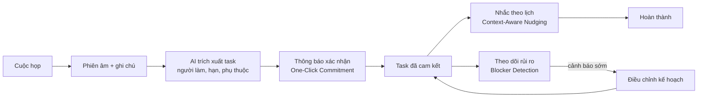

# Wiki dự án: App ghi chú họp có cam kết và nhắc việc thông minh

> Cập nhật lần cuối: 2026-11-14 · Trạng thái: giai đoạn 1 đã có code chạy được trên máy (xem [README của mã nguồn](../README.md) và [Roadmap](11-roadmap.md)); giai đoạn 2 trở đi mới là thiết kế

App ghi chú cuộc họp bằng AI theo hướng [Granola](https://www.granola.ai/) (ghi âm trực tiếp trên máy, không cần bot tham gia cuộc họp, AI biến ghi chú thô thành biên bản), cộng thêm ba tính năng để **việc sau cuộc họp thực sự được làm**:

| Tính năng | Một câu mô tả | Trang |
|---|---|---|
| One-Click Commitment | Sau buổi họp, mỗi người nhận thông báo và xác nhận task của mình bằng một cú bấm | [03](03-one-click-commitment.md) |
| Context-Aware Nudging | Nhắc việc vào khoảng trống giữa hai cuộc họp, hoặc 2 tiếng trước cuộc họp cần báo cáo | [04](04-context-aware-nudging.md) |
| Blocker Detection | Việc A sắp trễ mà việc B phụ thuộc vào A → cảnh báo sớm cho người làm B và quản lý | [05](05-blocker-detection.md) |

## Mục lục

**Sản phẩm**

1. [Tổng quan sản phẩm](01-tong-quan-san-pham.md) — vấn đề, người dùng, khác gì Granola
2. [Tính năng lõi](02-tinh-nang-loi.md) — ghi âm, phiên âm, ghi chú AI, tìm kiếm
3. [One-Click Commitment](03-one-click-commitment.md)
4. [Context-Aware Nudging](04-context-aware-nudging.md)
5. [Blocker Detection](05-blocker-detection.md)

**Kỹ thuật**

6. [Kiến trúc hệ thống](06-kien-truc-he-thong.md)
7. [Mô hình dữ liệu](07-mo-hinh-du-lieu.md)
8. [AI pipeline](08-ai-pipeline.md) — trích xuất task, phụ thuộc, ước lượng công sức
9. [Tích hợp](09-tich-hop.md) — lịch, Slack, email, push
10. [Bảo mật và quyền riêng tư](10-bao-mat-quyen-rieng-tu.md)

**Kế hoạch**

11. [Roadmap](11-roadmap.md)
12. [Quyết định còn mở](12-quyet-dinh-mo.md) — những thứ cần chốt trước khi code

**Tra cứu**

- [Thuật ngữ](thuat-ngu.md)

## Vòng đời một task, từ cuộc họp đến khi xong

## Quy ước viết wiki

- Mỗi trang một chủ đề, tên file không dấu, có số thứ tự ở đầu.
- Liên kết giữa các trang dùng đường dẫn tương đối, ví dụ `[Roadmap](11-roadmap.md)`.
- Sơ đồ viết bằng Mermaid (GitHub và Obsidian hiển thị sẵn; VS Code cần extension Mermaid).
- Điều gì chưa chốt thì ghi vào [Quyết định còn mở](12-quyet-dinh-mo.md), không viết như thể đã quyết.
